<p align="center">
  
</p>

<p align="center">
  
</p>

```kotlin
object LuisFialho {
    val location = "Portugal"
    val dayJob   = "Solar PV engineer - commercial & industrial plants, 4+ years"
    val nightJob = "Indie developer"
    val ships    = listOf("Android apps", "custom websites", "drone mapping tools", "AI tooling")
    val stack    = listOf("Kotlin", "Compose", "TypeScript", "Next.js", "GDScript", "Python", "Rust")
    val style    = "small, polished, offline-first software"
}
```

<p align="center">
  
</p>

<p align="center">
  <a href="https://openviewiptv.com"></a>
</p>
<p align="center">
  <a href="https://openviewiptv.com"></a>&nbsp;&nbsp;
  <a href="https://play.google.com/store/apps/details?id=com.openview.iptv"></a>
</p>

<p align="center">
  <a href="https://github.com/LuisPCFialho/swipe-knight-releases"></a>
</p>
<p align="center">
  <a href="https://github.com/LuisPCFialho/swipe-knight-releases/releases/latest"></a>
</p>

<p align="center">
  <a href="https://luispcfialho.github.io/padel-stats-releases/">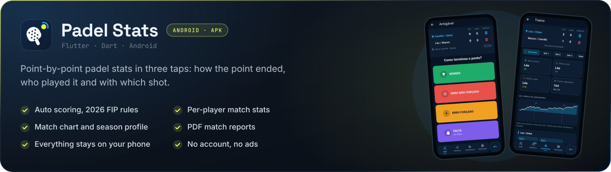</a>
</p>
<p align="center">
  <a href="https://luispcfialho.github.io/padel-stats-releases/"></a>
</p>

<p align="center">
  
</p>
<p align="center">
  <a href="https://github.com/LuisPCFialho/drone-tycoon-idle"></a>
  <a href="https://github.com/LuisPCFialho/luisolingo-releases"></a>
</p>

<p align="center">
  
</p>
<p align="center">
  <a href="https://open-flight-planner.vercel.app/">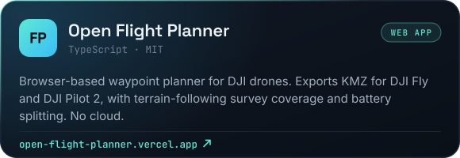</a>
  <a href="https://github.com/LuisPCFialho/webodm-real-progress">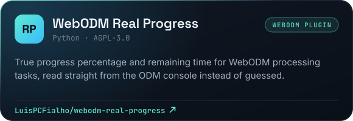</a>
</p>
<p align="center">
  <a href="https://github.com/LuisPCFialho/recortar-obj-webodm-app">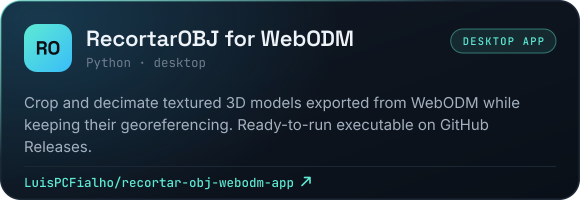</a>
</p>

<p align="center">
  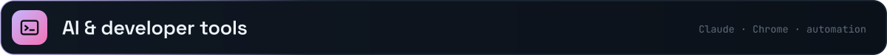
</p>
<p align="center">
  <a href="https://github.com/LuisPCFialho/claude-fuel-gauge">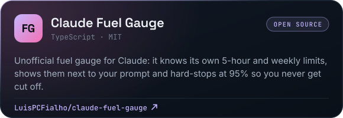</a>
  <a href="https://github.com/LuisPCFialho/extension-factory"></a>
</p>
<p align="center">
  <a href="https://github.com/LuisPCFialho/BananaWare"></a>
  <a href="https://github.com/LuisPCFialho/linkedin-to-site"></a>
</p>

<p align="center">
  
</p>
<p align="center">
  
  <br>
  
</p>

<p align="center">
  
</p>
<p align="center">
  
</p>
<p align="center">
  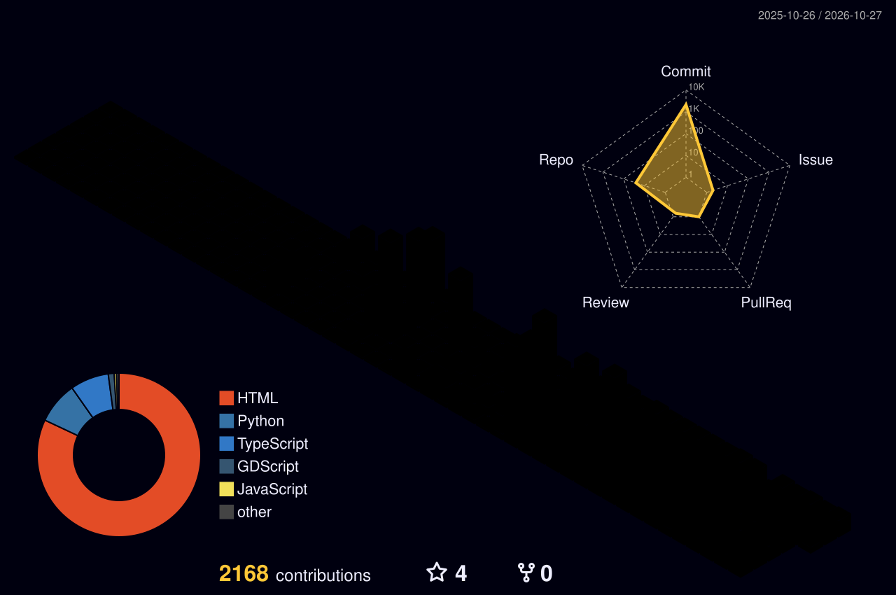
</p>
<p align="center">
  <picture>
    <source media="(prefers-color-scheme: dark)" srcset="assets/generated/snake-dark.svg">
    <source media="(prefers-color-scheme: light)" srcset="assets/generated/snake-light.svg">
    
  </picture>
</p>

<p align="center"><sub>Hand-made SVGs · stats, 3D graph and snake refreshed daily by GitHub Actions</sub></p>
